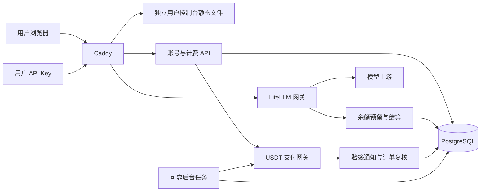

# CocaAPI 用户与计费产品规格

日期为 2026-11-01，整体计费产品仍为规划稿。用户后续指定的账号首版已部署，真实 OAuth 和 SMTP 验收等待配置，其余功能未上线。当前范围和工程调整见实施计划及 `deploy/cocaapi/AUTH.md`

## 目标与边界

建立可自助使用的多用户 API 服务，完成注册、验证邮箱、登录、兑换或充值、创建 Key、调用模型、扣款和查询账单的完整流程

已确认使用 LiteLLM fork，自建用户和商业计费功能。USDT 使用第三方支付网关，期望覆盖 TRON、Ethereum、BNB Smart Chain，服务商尚未选定

已确认 fork New API 作为用户、钱包、兑换码与 OAuth 的参考，第一批 OAuth 注册登录平台为 GitHub、Google、NodeLoc。源码参考及提供商核对记录见 `docs/design/2026-11-01-new-api-reference-and-oauth.md`

用户中心沿用现有界面风格，管理员保留 `/ui/`。账号首版提供邮箱验证，新用户网关额度为零，发布初始注册关闭。单一美元计价钱包属于后续实施范围

第一版包含邮箱和 OAuth 账号、外部身份绑定、余额账本、API Key、消费预留和结算、兑换码、单次 USDT 充值、模型价格展示及运营管理。套餐订阅、邀请返佣、代理商、提现、自动退款、多币种内部钱包和自建链上监听列入后续版本

## 当前工程基线

线上账号镜像基于官方 `v1.106.6` 固定摘要并加入本期账号模块，PostgreSQL、Redis、Caddy 部署在 `141.98.197.58`。账号分支为 `litellm_account_auth`，原来基于 main 的 `litellm_user_wallet` 保留

开发先以 `v1.106.6` 建立稳定基线，保留现有分支，不重写历史。以有明确来源的提交迁入部署文件与规格，使用新功能分支和自定义镜像发布。升级到更新的 LiteLLM 稳定版另作一次兼容性评估

`v1.106.6` 已有 `litellm/models`、`litellm/repositories` 及用户仓储，但没有当前 main 的 `litellm/proxy/deps` 目录。实现不能直接复制 main 的依赖接线并假定可运行，应复用稳定版现有连接生命周期，按需补充最小的仓储依赖

线上目前未配置上游模型或 SMTP，未选定支付商户账户。上述配置不影响开始开发和本地测试，但会影响邮件、真实推理和支付沙箱的最终验收

## 页面与访问分工

| 地址 | 用途 |
| --- | --- |
| `/` | 产品介绍、模型价格入口、登录和注册 |
| `/account/register/` | 邮箱注册、验证邮件发送结果 |
| `/account/verify/` | 邮箱验证结果 |
| `/account/login/` | 邮箱密码与 GitHub、Google、NodeLoc 登录 |
| `/account/forgot-password/` | 重置邮件申请 |
| `/account/reset-password/` | 设置新密码 |
| `/console/` | 可用余额、冻结额度、近期消费和常用入口 |
| `/console/keys/` | 创建、查看元信息、禁用和删除个人 Key |
| `/console/wallet/` | 充值金额和网络选择、兑换码入口 |
| `/console/orders/` | 充值订单、支付状态与异常提示 |
| `/console/usage/` | 按时间、模型、Key 查询个人消费 |
| `/console/transactions/` | 充值、兑换、扣费和调整流水 |
| `/console/models/` | 当前可调用模型、计价方式、倍率及限制 |
| `/console/settings/` | 密码修改、OAuth 绑定与解绑、退出登录 |
| `/ui/commerce/` | 管理员查看账户、订单、兑换码、价格、异常结算及操作记录 |

## 架构

后端在 fork 内增加 `commerce` 模块，沿用 Python、FastAPI、Prisma 与现有 PostgreSQL，不增加独立账号数据库或第二套模型路由。后台任务独立进程运行同一镜像，处理事务 outbox、支付复查和待对账请求

账号首版根据保持现有风格的要求，复用 `ui/litellm-dashboard` 的 React、TypeScript、Next.js 与组件，在 `/account/` 输出独立用户页面。静态产物随网关镜像发布，开发机完成构建，生产机不运行 Node 开发服务器。用户会话和 API 与管理员入口分离

账号 API 使用 `/account/api/v1`，管理 API 使用 `/commerce/admin/v1`，支付回调使用 `/commerce/webhooks/{provider}`。现有 `/v1` 模型接口继续由 LiteLLM 处理，付费用户不能通过其他 LiteLLM 推理路径绕过钱包检查

用户身份复用 `LiteLLM_UserTable.user_id`。新增客户资料与它一对一绑定。客户密码复用现有哈希和校验原语，仅存于 `CommerceCustomer.password_hash`，原生用户 password 为 NULL，以避免原生后台登录绕过用户中心限制。用户中心使用单独的受限会话，不向浏览器提供 master key，也不维护另一份同步密码

## 注册与登录

注册模式提供关闭、邀请和公开三种状态，发布初始为关闭。注册请求只能提交邮箱、密码及必要验证信息，服务端固定创建普通用户，客户端不能设置角色、余额、分组权限或可用模型

邮箱去首尾空白并按产品约定转换为小写，在客户资料表中使用数据库唯一约束防止并发重复注册。已有管理员或内部用户的邮箱不能被公开注册流程自动认领

验证邮件和重置密码令牌随机生成，数据库只保存令牌摘要与用途。推荐邮箱验证有效期 24 小时，重置令牌有效期 30 分钟，重发使旧令牌失效。验证、密码重置成功和令牌消费处于同一事务

上述摘要约束适用于令牌表。发信 outbox 若需暂存包含令牌的链接，使用独立版本化密钥加密载荷，发送完成后清理载荷，不能把可直接使用的链接写入普通日志或长期明文任务记录

未验证用户只可重新发送验证邮件、验证或退出，不能创建 Key、兑换或发起充值。注册成功不赠送余额，后续活动赠送通过可追踪的流水实现

会话使用 HttpOnly、Secure、SameSite Cookie，服务端保存摘要、用户、到期和撤销状态。推荐会话绝对有效期 7 天。密码修改或重置后撤销其他会话，禁用账号时同时撤销会话和模型调用资格

修改资源的请求校验 Origin 和 CSRF 令牌。注册、验证邮件重发、登录、密码重置及兑换实施按账户和可信来源 IP 的限流，邮箱是否存在不通过重置接口直接暴露

## OAuth 注册、登录与账号绑定

GitHub 使用 OAuth 授权码流程，以数值用户 id 标识身份。Google、NodeLoc 使用 OIDC，以可信 issuer 与 sub 标识身份。邮箱、用户名和显示名不作为外部身份主键，也不作为自动合并账户的依据

首次 OAuth 登录在全局与提供商注册策略允许时，事务创建普通用户、客户资料、零余额钱包和外部身份关联。已有外部身份直接登录原账户；同邮箱存在但尚未关联时，要求登录原账户后显式绑定，不自动新建重复钱包或合并账户

OAuth-only 用户允许尚未设置本地密码，客户资料邮箱可暂为空。只有来自配置中受信任提供商且已通过验证的邮箱声明才能满足邮箱验证要求；GitHub 需核对邮箱接口的 verified 与 primary。邮箱缺失或未验证时进入补充邮箱流程，未完成前继续执行原有 Key、兑换与充值限制

外部身份使用 `(issuer, subject)` 数据库唯一约束，同一个客户对同一个配置提供商最多绑定一个身份。新增绑定不改变 user_id、余额、历史账单或 Key，不因邮箱后来变化迁移账户

授权采用服务端换 token，使用一次性 state、浏览器绑定、受限有效期和 provider/用途绑定。GitHub 与 Google 使用 S256 PKCE，OIDC 校验 ID token 签名、issuer、audience、有效期、nonce 和 userinfo subject 一致性，NodeLoc 的 PKCE 能力按参考记录完成实际应用验证后配置，不能自动降级

OAuth 事务保存在可被两个 worker 共享的持久化存储，原子消费并阻止重放。短时浏览器 Cookie 与服务端事务关联，仅提供一个 state 不能完成登录。nonce 和 PKCE verifier 使用短期加密存储并按到期清理。provider、回调、绑定目标和返回地址在开始时固定，回调时不能重新指定

登录完成统一签发 CocaAPI 的受限 Cookie，会话 token 不进入 URL 或 localStorage。第三方 access token 用完即弃，第一版不保存 refresh token。回调日志隐藏授权码、state、ID token 和其他可用凭据

绑定或解绑须有当前账户会话及近期重新认证，回调验证原始绑定会话仍有效。禁止解绑最后一个可用登录方式；没有本地密码时，可在验证邮箱和重新认证后设置密码

全局关闭注册不会阻止已有外部身份登录，但会拒绝新身份自助开户。提供商可独立启停和控制自动注册，用户禁用对所有登录方式生效，不使用外部角色声明授予管理员权限

管理员配置提供商启停、Client ID、密钥引用、受信任 Discovery、允许 scopes 和精确回调地址。密钥只在服务端保存并脱敏显示，客户端不能选择 issuer 或 token endpoint。用户中心的 OAuth 不依赖 LiteLLM 企业版管理后台 SSO

第一版的精确回调地址为 `https://cocaapi.com/account/api/v1/oauth/github/callback`、`https://cocaapi.com/account/api/v1/oauth/google/callback`、`https://cocaapi.com/account/api/v1/oauth/nodeloc/callback`。它们是尚未实现的规划接口

## 钱包与账本

界面显示美元计价的 API 消费额度，保留可用余额与冻结额度。它不能提现，也不代表链上 USDT 余额

内部金额采用整数，`1 USD credit = 1,000,000,000 units`。数据库使用 BigInt，接口金额单位字段使用十进制字符串，前端使用 BigInt 或精确十进制计算，不经过 JavaScript 浮点 Number 累加

已完成入账与已结算扣费形成不可改写的流水，余额快照、冻结额度和流水在同一事务中变更。流水至少包含用户、类型、业务唯一标识、金额、变更前后余额、关联请求或订单、操作者和时间

冲正生成关联原流水的补偿记录，不直接编辑或删除历史记录。管理员调整余额必须注明原因和业务标识，同一次请求重放不得重复调整

业务唯一键独立覆盖充值入账、兑换、请求结算和人工调整。余额快照由账本定期核对，发现差异标记异常并阻止继续扩大差额，不自动覆盖原始记录

## API Key 与定价

用户可以创建个人 Key，设置名称、有效期、模型范围、请求限制与单 Key 消费限制。Key 明文只在创建时显示一次，之后显示前缀、末尾与使用记录

同一用户所有 Key 共享钱包。客户 Key 的用户身份和权限由服务器固定，不能创建匿名所有者 Key、团队服务账号 Key 或将其他用户作为所有者。保留 LiteLLM 原有模型权限和限流校验

第一版推荐使用 `售价 = LiteLLM 最终计价成本 × 生效倍率`，后台显式配置全局与模型覆盖倍率，展示倍率和计价口径。每次请求保存价格版本与倍率快照，变价不修改历史账单

LiteLLM 成本属于网关计价口径，可能与供应商最终账单存在差异。源字段为 float 时，转成 Decimal 无法恢复已丢失的精度，需保存原始计价来源，并用明确的舍入规则生成整数售价

消费金额在请求级向上舍入至一个内部单位。充值获得的额度按订单报价固定，涉及兑换时向下舍入至一个内部单位。所有计算规则在账单中保持一致，零成本模型必须被管理员显式允许

初期只开放可可靠估算上限并结算的文本调用，覆盖 Chat Completions、Responses 与 Anthropic Messages 的流式和非流式路径。客户端工具调用输出按文本计价，内置付费工具、MCP、Agent、图像、音频、向量、后台和批处理等能力在建立计价与结算覆盖前，对付费账户明确拒绝

## 预留、结算与异常

调用前由服务端根据输入、允许输出上限和价格版本计算预留额度，原子检查并冻结。没有输出上限时设置服务端上限，客户端不能靠另建 Key、换协议或超大参数绕过预留

余额不足时在上游调用前返回稳定业务错误。数据库不可用或预留结果不确定时不放行新的付费请求，不能回退成只记录日志

完成后保存可重放的持久化结算事件，按实际费用扣款并释放剩余冻结。不能仅依赖可能被进程终止的后台 callback 或内存队列。结果返回路径与事件持久化的关系需要逐协议验证

第一版以事前预留金额作为该请求的用户收费上限。实际费用意外超过预留时，超额部分记为平台差额并进入计价异常处理，不能透支钱包或事后无限追加收费。重复出现差额的模型在修正预留规则前暂停新增付费请求

失败重试区分供应商成本与用户售价。推荐只按最终交付的成功结果收费，供应商重试成本单独记录。连接取消、流式中断、进程终止和供应商已计费但 usage 不完整的情况进入明确的待对账状态

不确定请求不会因一个定时超时就无条件释放全部冻结。后台按持久化请求状态和上游结果补偿，无法确认的记录进入人工审核，用户可以看到冻结与处理状态

## 兑换码

管理员可按批次生成金额、数量、备注、有效期和状态。每码使用密码学安全随机数，推荐 160 位随机熵，使用易输入的分组格式，一码仅能被一个账户成功兑换一次

数据库保存带版本的 HMAC 摘要、显示尾号和批次元信息，不保存可直接使用的明文。明文仅在生成时显示和导出一次，响应丢失可作废未使用批次并重新生成

推荐批次数量上限 1000，默认有效期 90 天，管理员可显式选择不同期限。停用批次只影响未使用兑换码，已入账余额不因批次停用而消失

兑换验证和状态占用、钱包入账、流水写入处于同一事务。并发兑换只允许一个请求成功，入账失败时兑换码仍可使用。无效、过期和停用使用统一失败提示，个人流水保留成功记录

第一版只有金额兑换码，不增加可重复使用的优惠券、折扣叠加或自动返佣。兑换所得额度与充值额度具有相同的 API 消费用途，来源在流水中区分

## USDT 充值

候选网关为 NOWPayments，但它尚未被选定。接口适配层提供创建支付、查询支付、校验通知和可用网络查询，领域层只处理标准化订单状态

用户先选择获得的美元额度与支付网络，再由服务器获取并保存报价，创建本地订单和支付请求。更换网络需要新建订单，不能修改已存在订单的网络或金额

推荐平台采用 `1 USDT = 1 USD credit` 的业务兑换规则，手续费由支付页单列，是否由用户承担写入订单报价。这是可配置的产品规则，不假定所有网关都能使用同一报价字段

展示的支付网络取平台允许列表与商户实时可用列表的交集。充值下限取平台规则和网关该网络最低金额的较大值，禁止展示一个并不能支付的固定网络选项

订单包括创建中、等待付款、确认中、已入账、过期、失败和待人工处理。网关已报告完成与本地已入账分开保存，只有钱包事务完成后向用户显示已入账

通知先按服务商文档验签，再持久化到 inbox，异步查询网关订单复核支付标识、订单、币种、网络、报价与到账状态。收件失败返回可重试状态，成功收件后即使服务重启也能继续处理

验签通过也不能根据客户端成功跳转直接加余额。重复和乱序通知最多产生一次入账，已入账订单不会被迟到的等待通知降级

少付、超付、报价过期后到账、网关退款和不支持的网络到账进入明确异常流程，第一版不自动加码补发或自动发起链上退款。管理员查单与补单也必须通过同一入账事务

定时复查未完成订单与长时间未处理通知，补偿回调漏发。创建支付超时不得盲目重新下单，应先用商户订单标识查询，避免一个业务订单出现多个不可关联的付款入口

若所选服务商不支持按商户订单标识复查且支付标识尚未返回，该订单保留为待核查，先人工关联确认，不能把假定存在的查询能力写进通用适配接口

NOWPayments 官方说明提供 API 与沙箱，通知需要按其 IPN 规则验证签名，并说明了 Cloudflare 可能阻挡通知。上线时必须逐一验证网关到实际回调域名的到达和重试行为

官方 API https://nowpayments.io/api

官方 IPN https://nowpayments.zendesk.com/hc/en-us/articles/21395546303389-IPN-and-how-to-setup

## 新增持久化对象

| 对象 | 主要职责与约束 |
| --- | --- |
| CommerceCustomer | user_id 唯一、非空规范邮箱唯一、验证与禁用状态、计价方案，OAuth 待补充邮箱时允许为空 |
| CommerceSession | 会话摘要唯一、用户、有效期、撤销状态 |
| CommerceActionToken | 验证或重置用途、摘要唯一、到期、消费状态 |
| CommerceOAuthProvider | 提供商配置、受信任 issuer/Discovery、密钥引用、scope、能力与启停策略 |
| CommerceExternalIdentity | issuer 与 subject 组合唯一、客户关联、配置提供商与必要显示资料 |
| CommerceOAuthFlow | state 摘要、浏览器绑定、nonce、PKCE、用途、目标会话、到期与消费状态 |
| CommerceWallet | user_id 唯一、余额与冻结整数、非负约束与版本 |
| CommerceLedgerEntry | 不可改写流水、业务唯一键、关联对象和余额快照 |
| CommerceReservation | 请求唯一标识、冻结额度、价格快照、结算或待对账状态 |
| CommercePriceRule | 生效范围、倍率、版本与生效时间 |
| CommerceRechargeOrder | 所有者、网关订单唯一映射、报价与支付及入账状态 |
| CommerceWebhookInbox | 已验证通知、去重标识、接收与处理状态 |
| CommerceOutbox | 邮件、结算和补偿任务、幂等业务键、租约与重试 |
| CommerceRedeemBatch | 面额、总量、有效期、启停与生成操作者 |
| CommerceRedeemCode | 摘要唯一、尾号、批次、使用人和使用时间 |
| CommerceAdminAudit | 管理操作、关联对象、前后变化摘要与原因 |

任务使用数据库租约认领，支持多 worker 与重启恢复。数据库是最终资金依据，Redis 用于限流和可丢弃缓存，不承担唯一的资金事实

## 管理员功能

新增商业管理页面查看用户余额、冻结额度、充值订单、兑换批次、个人消费汇总、价格和异常结算。允许禁用账号、调整模型权限、调整余额、停用未使用兑换码和复查订单

登录配置页面管理 GitHub、Google、NodeLoc 应用，显示精确回调地址、配置状态与注册策略。未配置完整的提供商不显示可用登录按钮，不能给用户一个无法完成的登录入口

商业管理 API 必须验证现有管理员身份，普通用户和用户中心会话均不能调用。金额调整、价格变更、补单和兑换批次生成记录操作者、原因和结果

已有付费客户采用停用处理，不能通过原有用户删除入口级联抹掉资金历史。删除与注销路径需要检查关联账本，返回明确冲突或进入保留记录的注销流程

## 发布顺序与验收

先完成基线与账本，再完成消费预留结算和账号，随后接兑换码，最后接 USDT 网关。开发期间注册和充值入口保持关闭，不能先放开公众充值再补扣费实现

第一里程碑是邮箱与三家 OAuth 内测账号、身份绑定、Key、人工带审计加款、真实扣费和消费查询。第二里程碑增加兑换码。第三里程碑完成 USDT 沙箱及真实商户验证。最后经过预发布完整流程后开启公开注册和充值

上线必须验证两个 worker 下多 Key 共享余额、并发预留、同码并发兑换、重复支付通知、支付超时、数据库提交失败、流式中断和进程重启。包含实际 PostgreSQL 事务、可控上游集成测试、网关沙箱和真实模型调用，不能仅以单元测试代替

需要交付注册成功、到账、扣费、拒绝余额不足和查账的浏览器证据，确认旧管理后台和普通内部用户的预算功能没有回归

三家 OAuth 各自验证首次注册、重复登录、取消授权、绑定、解绑与提供商失败。补充 state 重放、跨浏览器、提供商混淆、错误 ID token、同邮箱冲突和并发开户测试，证明多种登录方式看到同一个钱包。真实测试应用授权成功前不能将该提供商标记为已完成接入

## 预计工作量与实施依赖

按单人连续开发和验收粗估 18 至 30 个工作日，基线与数据设计 2 至 3 天，账号、三家 OAuth 和控制台 6 至 10 天，钱包与调用结算 5 至 8 天，兑换码 1 至 2 天，支付与发布验证 4 至 7 天。实际耗时受上游接口与终止路径的兼容性影响，支付开户、OAuth 应用和邮件服务等待时间另计

开发初期不需要支付密钥。邮件最终验收需要 SMTP 和发信域名，支付最终验收需要所选服务商的商户配置、沙箱密钥与签名密钥，真实推理验收需要已授权上游模型。模型售价、手续费承担和活动额度在付费发布前作为经营配置确定

OAuth 最终验收需要 GitHub、Google 与 NodeLoc 的测试应用 Client ID、Client Secret 和回调白名单。先用模拟提供商覆盖故障与事务测试，配置完成后再进行三家真实授权，不将生产凭据写入仓库或计划文档
